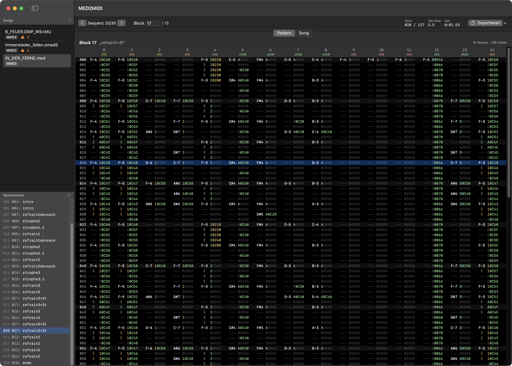
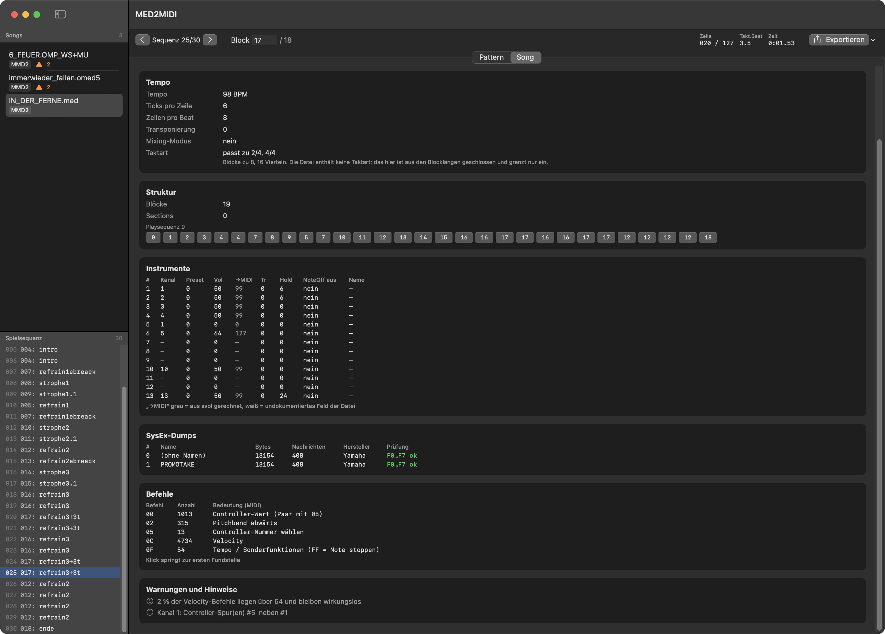

# med2midi

**Converts OctaMED / MED SoundStudio songs (MMD0–MMD3) to Standard MIDI Files,
SysEx dumps and WAV samples. It is not a tracker and it does not play anything.**



*The format findings in [`docs/`](docs/) are written in German —
[see below](#the-documents-are-in-german).*

## What this is, and what it is not

This is a **converter**, written for one very specific problem: mine.

I composed music on an Amiga in the 90s, using OctaMED with external 
MIDI gear — a Yamaha MU80 and a Korg Wavestation. The songs survived
as MMD files. I wanted them in a DAW with their musical content intact, so I
could re-instrument them with modern sounds.

Everything here follows from that goal:

- **It does not play audio.** It shows patterns so they can be compared against
  the original in an Amiga emulator, and it writes files.
- **It is not a tracker.** No editing, no sequencing, no mixing. Nothing is
  written back to the MMD file; the loader has no write path at all.
- **It does not aim at sample playback fidelity.** Samples are extracted as
  WAV so a DAW sampler can use them, but Paula emulation, synth instruments,
  mixing mode and audio effects are out of scope.

If you want to *play* MED files, use [OpenMPT](https://openmpt.org),
[libxmp](https://github.com/libxmp/libxmp) or [UADE](https://zakalwe.fi/uade/).
They are better at that and always will be.

## Why it exists

The MIDI side of the MMD format is poorly documented and, where it is
documented, partly wrong. Every OctaMED version I tried exported MIDI that lost
something: velocities, note lengths, controller streams, or the SysEx dumps
entirely.

So I rebuilt the export from the ground up, and **measured every behaviour
against the original** — on the real hardware, in an Amiga emulator with a MIDI
monitor, or in OctaMED's own 68k play routine.

**The documentation is the more valuable part of this repository.** The Swift
code is replaceable; the findings are not.

## What was found

A selection, each measured rather than assumed:

| Finding | Why it matters |
|---|---|
| Command `0C` velocity scales as `⌊v × 127/64⌋`, and values above 64 are **ignored**, not clamped | Three sources disagreed; the device settled it |
| Velocity applies only **until the next instrument number**, not until the next `0C` | A whole drum track was 30 % too quiet from the middle of a song onwards |
| Note length is a tick counter: `hold`, plus one row per cell carrying only an instrument number — **regardless of any command in that cell** | Notes spanning twelve rows came out one row long |
| The octave offset is **−1**: MED note 1 is MIDI note 0 | Earlier guesses were three octaves out |
| The `FLAG_VOLHEX` flag decides whether `0C` values read as decimal or hexadecimal, **at playback time** | Same pattern data, different MIDI output |
| OctaMED's period table starts at `per0`; the two rows above it are conditionally assembled | Sample playback rates were two octaves out |
| MU80 dumps follow the XG multi-part layout; Korg Wavestation dumps are **nibble-packed, low nibble first** | Patch names are readable from both |

### The documents are in German

> `docs/` holds about 2 000 lines of findings, and they are written in **German**.
>
> They are my working notes, kept in the language I made them in. Translating
> them would have meant rewriting them, and precision mattered more to me than
> reach: every claim sits next to the measurement that supports it, and several
> of them correct existing references. Rewriting that in a second language
> invites exactly the kind of quiet drift the documents exist to prevent.
>
> The table above is the summary in English. For the detail, machine
> translation copes well — the vocabulary is technical and the structure is
> plain. If a specific finding matters to you and the translation is unclear,
> open an issue and ask — I would rather explain it than have it misread.

| Document | Contents |
|---|---|
| [`01-quellen-und-befunde.md`](docs/01-quellen-und-befunde.md) | Source ranking, contradictions between the references, measurements on real files, the verified timing model |
| [`02-befehlskatalog.md`](docs/02-befehlskatalog.md) | The command catalogue: what each pattern command does for a MIDI instrument, with five documented errors in Tutka |
| [`03-testpattern-emulator.md`](docs/03-testpattern-emulator.md) | How each behaviour was measured in the emulator |
| [`04-mu80-dumps.md`](docs/04-mu80-dumps.md) | Yamaha bulk dump framing, the XG multi-part layout, and a repair for bit rot |
| [`05-samples.md`](docs/05-samples.md) | Where sample data sits, and OctaMED's period table |
| [`06-wavestation.md`](docs/06-wavestation.md) | The Korg Wavestation dump, and how its patch names were recovered |

## What it produces

```
<target>/<song name>/
    <song>.mid              Standard MIDI File, type 1, timing exact
    <song>-entzerrt.mid     same, with note-offs and controllers pulled early
    samples/
        NN-name.wav         one per sample, 16-bit, with playback rate and root key
        samples.txt
    sysex/
        …-dumpNN.syx        one per dump, damaged bytes repaired where provable
        dumps.txt           checksums, trigger locations, sending advice
        parts.txt           MU80 part layout, grouped by MIDI channel
        wavestation.txt     Korg patch names, matched to the song's instruments
```

The second MIDI file exists because a DIN cable carries 3125 bytes per second,
and a dense chord fires up to 99 bytes on one tick — 32 ms before the last note
arrives. Pulling note-offs a quarter row early halves that without changing
anything audible.

## Using it

Requires macOS and a Swift 6 toolchain. There are no dependencies.

**No binaries are published**, on purpose. An unsigned `.app` is blocked by
Gatekeeper, and the workaround — stripping the quarantine attribute by hand —
is a worse first impression than a one-line build. Doing it properly would
mean notarisation and an Apple developer account, which is not worth it for a
tool this specialised. Building takes a few seconds.

```sh
swift build -c release

# Overview, pattern view, event list
.build/release/medprobe song.med
.build/release/medprobe --block 2 --zeilen 0-31 song.med
.build/release/medprobe --events --alle song.med

# Full export
.build/release/medprobe --export out/ song.med

# The app
./Werkzeuge/installieren.sh      # builds and installs to /Applications
```



The app loads whole folders, recognising MMD files by their header rather than
their extension — on the Amiga they had none.

## Tests

```sh
swift test
```

76 tests. Those that need real songs skip cleanly when `songs/` is absent; my
own material is not part of this repository. Each test that encodes a measured
behaviour says, in its comment, what was measured and how.

## Status and limits

Written for my songs, and shaped by them. In particular:

- **MIDI instruments are the focus.** Sample instruments get notes and WAV
  files, but synth and hybrid instruments are not interpreted.
- **Flow control is not modelled.** Commands `0B`, `1D`, `1E`, `1F` and
  `0F 00` would change the running order; none of them occurs in my material,
  so they are reported as warnings rather than executed.
- **Mixing mode is ignored**, along with everything that only affects Paula.
- Some behaviours are confirmed by a single measurement. Where that is the
  case, the documentation says so.

Interoperability work — corrections for OpenMPT, libxmp or UADE — is welcome,
and I licensed the findings under MIT precisely so they can be used that way.

## A word on the material

The songs themselves are not in this repository, and neither are the exports —
it is my own music. What remains visible are the file names and the block names
inside them, in the screenshots and in the tests. That is deliberate: a finding
like *"in `N_ich_will_neues`, block 2, track 3, the eleven hold rows each carry
a command"* can be checked by anyone holding the same file. An anonymised
version would read as an assertion rather than a measurement.

Tests that need real songs skip cleanly when `songs/` is absent.

## Sources

- Teijo Kinnunen, `MMD_FileFormat.doc` rev. 6 — the format specification
- OpenMPT, `soundlib/Load_med.cpp` — the most complete reader in the wild
- Tutka, `conversion.cpp` — a second opinion, with five documented errors
- OctaMED's own 68k play routine, as shipped with UADE
- [The OctaMED SoundStudio manual](https://retro.pasz.nl/resources/octamed-soundstudio-manual/),
  Appendix A in particular
- An Amiga emulator, a MIDI monitor, a Yamaha MU80, and my own ears

## Licence

MIT. See [LICENSE](LICENSE).

The brief I started from is kept as
[`med2midi-projekt-prompt.md`](med2midi-projekt-prompt.md), in German.
